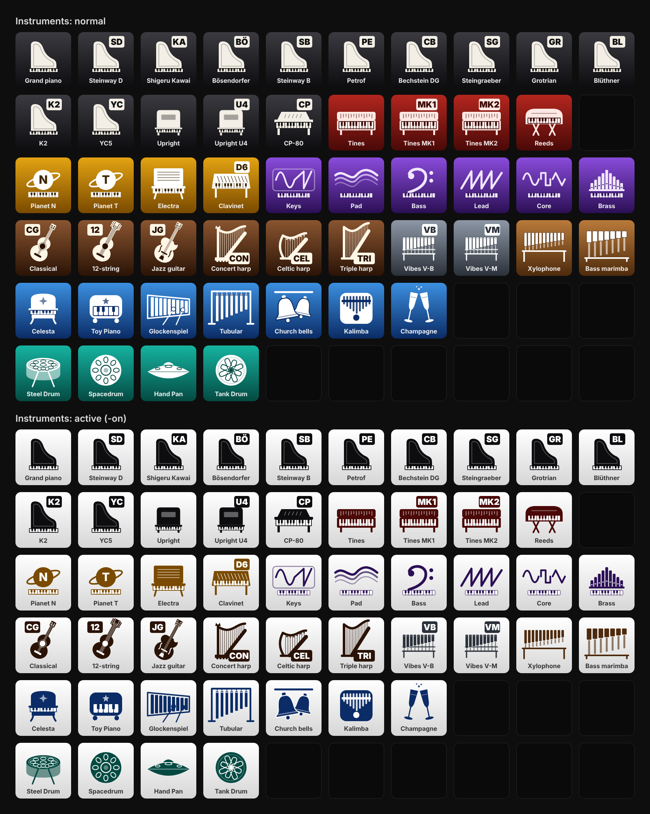
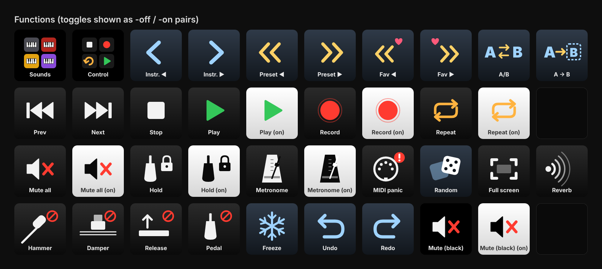
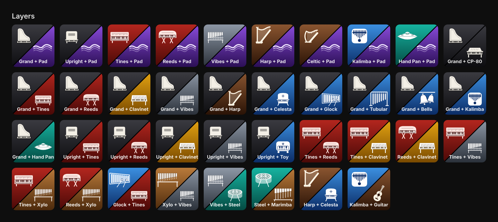

# pianoteq-icons

Unofficial icon set for controlling [Pianoteq](https://www.modartt.com/pianoteq) from an Elgato Stream Deck XL.

The set has three groups of keys:
- **instruments:** one key per instrument family or preset.
- **functions:** navigation, MIDI recorder transport, toggles and one-shot actions.
- **layers:** two-instrument layers and morphs on a diagonal split.

The icons have no embedded text. The bottom of each key is left free for the title that Stream Deck draws over the image. The titles in the previews below are only samples.

## Instruments



## Functions



## Layers



## Using the icons

PNG files (96 × 96 px, the native Stream Deck XL key size) are in `icons/`:

| Folder | Contents | File names |
| --- | --- | --- |
| `icons/instruments` | Instrument keys | `<id>-off.png` (normal) and `<id>-on.png` (active, inverted colours) |
| `icons/functions` | Function keys | `<id>.png` for one-shot keys, `<id>-off.png` / `<id>-on.png` for toggles |
| `icons/layers` | Layer keys | `layer-<upper-left>-<lower-right>.png` |

In the Stream Deck app, drag a PNG onto the key image. For a multi-action switch or a toggle, use `-off` for state 1 and `-on` for state 2.

## Building from source

Every icon is generated from SVG code in `src/` and rendered with headless Chromium:

| File | Role |
| --- | --- |
| `src/themes.js` | Colour themes and the inverted active state |
| `src/glyphs.js` | Glyph library (SVG drawing functions) |
| `src/svg.js` | Key and layer composition, badges |
| `src/sets.js` | Lists of instrument, function and layer keys |
| `src/build.js` | PNG export and preview canvases |
| `src/fonts/` | Inter (SemiBold to Black), SIL Open Font License |

Requirements: Node.js 18 or later. The [Inter](https://rsms.me/inter/) font used for badges and letters is bundled in `src/fonts` and embedded at build time, so nothing needs to be installed system-wide.

```sh
npm install
npx playwright install chromium
npm run build                          # icons + previews
node src/build.js icons --size=144 --out=build-144   # another size, in a separate folder
```

To add an icon, add an entry to `src/sets.js` (and a glyph to `src/glyphs.js` if needed), then rebuild.

## License

The icons are released under [CC BY 4.0](https://creativecommons.org/licenses/by/4.0/) and the source code under the MIT License. See [LICENSE](LICENSE). The bundled Inter font is © The Inter Project Authors and licensed under the [SIL Open Font License 1.1](src/fonts/OFL.txt).

## Disclaimer

This is an unofficial community project. It is not affiliated with or endorsed by Modartt or Elgato. Pianoteq is a trademark of Modartt, and Stream Deck is a trademark of Corsair Memory, Inc.
